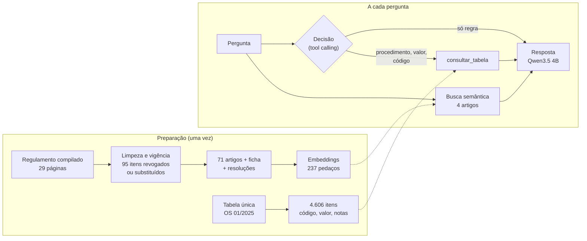

# Assistente do Regulamento de Saúde do IPASEM

Chatbot que tira dúvidas de beneficiários sobre o plano de saúde do IPASEM (Novo Hamburgo/RS),
citando o artigo e a página de onde tirou cada informação. Roda 100% local, com modelos abertos:
nenhum dado sai do computador.

> **Projeto pessoal de estudo, não é canal oficial do IPASEM.** Usa apenas documentos públicos
> (regulamento e resoluções do Conselho Deliberativo). As respostas podem conter erros e não
> substituem o atendimento do Instituto.

<!-- Demonstração: grave o chat em ação e salve como docs/demo.gif, depois descomente a linha abaixo.

-->

## O problema

O regulamento de assistência à saúde tem 29 páginas e é uma versão compilada: a redação de 2012
convive com 19 resoluções de alteração (de 2012 a 2023), lado a lado no mesmo PDF. A regra de consultas de
psiquiatria, por exemplo, aparece em três versões na mesma página. Valores e códigos de
procedimentos ficam em outra resolução, uma tabela de 164 páginas republicada todo ano por
ordem de serviço.

Responder "quantas consultas de psiquiatria eu tenho?" ou "quanto pago num implante dentário?"
exige saber qual versão vale e cruzar documentos diferentes.

## Como funciona

**RAG (Retrieval-Augmented Generation)** funciona como uma prova com consulta: o modelo não é
treinado com o regulamento. Os documentos são preparados uma vez e guardados fora do modelo. A
cada pergunta, o sistema procura os trechos relevantes e entrega ao modelo junto com a pergunta.



## Decisões que fizeram diferença

1. **Vigência antes de tecnologia.** O PDF mistura regras em vigor e revogadas. O script de
   preparação descarta 95 itens (65 substituídos por nova redação, 14 revogados, 11 de seção
   revogada, 5 de artigo reescrito ou renumerado) e guarda o motivo de cada descarte para
   auditoria. Sem isso, o chatbot citaria regra revogada com página e tudo.
2. **Busca em pedaços pequenos, resposta com o artigo inteiro.** O Art. 51 lista 22 exclusões;
   num vetor só, "vacinas" ficava diluída. Cada parágrafo e alínea ganhou um vetor próprio, com o
   caput junto para dar contexto, e o modelo recebe o artigo completo.
3. **Ficha do regulamento.** RAG é bom em "o que diz a regra X" e fraco em "do que trata o
   documento". Uma ficha gerada a partir dos títulos resolve perguntas gerais.
4. **Tabela como ferramenta, não como texto.** Preço e código precisam vir exatos. A tabela virou
   dados estruturados, e o modelo a consulta por *tool calling*, decidindo quando e com qual termo
   (ele traduz "catarata" para "facectomia" sozinho).
5. **Decisão separada da resposta.** Com o contexto cheio, o modelo de 4B escrevia "vou consultar
   a tabela" em vez de chamar a ferramenta. Separando as etapas, passou a chamar em 4 de 4 casos.
6. **Tudo local.** Modelos abertos rodando via Ollama num PC de escritório, sem enviar dados para
   APIs externas. Num órgão de saúde, é a resposta para a pergunta da LGPD.
7. **Memória ligada ao artigo, não à "pergunta parecida".** Respostas corrigidas por uma pessoa
   ficam em `memoria.md`. Pergunta igual sai na hora; pergunta diferente só recebe a correção se
   ela estiver ligada a um artigo que a busca trouxe. Medido com o modelo de embedding, "O IPASEM
   paga vacina?" e "O IPASEM paga óculos?" (respostas opostas) dão 0,80 de semelhança, mais que
   "paga vacina?" e "cobre vacinas?" (mesma dúvida), 0,59: semelhança não diz se é a mesma dúvida.
   Respostas já geradas ficam num cache (47 s na primeira vez, instantâneo depois), descartado
   sozinho quando código, dados ou correções mudam.
8. **Conversa pela reescrita da pergunta, não pelo histórico no prompt.** "E de clínico geral?"
   vira "Quantas consultas de clínico geral posso fazer?" antes da busca (~5 s a mais). Só essa
   etapa vê a conversa: mandar o histórico para a resposta aumentaria a leitura do prompt, que já
   é a parte mais lenta. Daí em diante tudo funciona igual, inclusive a memória e o cache.
9. **Sem sorteio onde a tarefa é mecânica.** Com a temperatura padrão, duas rodadas iguais do eval
   discordaram em 5 das 22 decisões de consultar a tabela, e a reescrita deu 5/8 e 4/8 com o mesmo
   prompt. Decisão e reescrita usam temperatura 0; a resposta mantém o sorteio (o Qwen avisa que
   sem ele modelos pequenos entram em repetição), mas com semente fixa: a mesma pergunta dá a
   mesma resposta, e o eval mede só o que mudou.

## Resultados

**Busca** (13 perguntas de beneficiário, com o artigo esperado):

| Configuração | Artigo certo em 1º | Entre os 4 primeiros |
|---|---|---|
| Um vetor por artigo | 7/10 | 9/10 |
| + instrução na consulta | 8/10 | 9/10 |
| + pedaços pequenos, resposta com artigo inteiro | 9/10 | 10/10 |
| + ficha do regulamento e resolução do implante (13 perguntas) | **12/13** | **13/13** |

**Tool calling** (o modelo usa a tabela quando precisa?):

| Tentativa | Resultado |
|---|---|
| Ferramenta junto com os artigos | 0 de 3 chamadas |
| Regra como "primeiro passo" | 1 de 2 (na outra, escreveu "vou pesquisar" e parou) |
| Decisão separada da resposta | **4 de 4**, e nenhuma chamada quando não precisava |

**Respostas** (22 perguntas com gabarito; correção automática por fatos obrigatórios e proibidos,
mais uma planilha para revisão humana em `evals/resultados/`):

| Configuração | Respostas certas | Decisão da tabela certa | Tempo médio |
|---|---|---|---|
| Primeira medição (temperatura padrão) | 18/22 | 16/18 | 42 s |
| Decisão com temperatura 0 e semente fixa (atual) | **18/22** | **16/18** | **34 s** |
| Testado e descartado: Ficha do regulamento só quando vem em 1º | 16/22 | 16/18 | 30 s |

Tirar a Ficha (o maior trecho) deixava a resposta 4 s mais rápida, mas em 2 perguntas o modelo
parou de informar o valor da tabela. Os 4 erros que sobram: resposta vaga sobre o que é o
regulamento, carência (a busca não traz o Art. 63 quando a pergunta fala em "consulta"),
psicologia (não consulta a tabela, onde está o limite de 30 sessões) e polissonografia (aplica o
Art. 22 e divide o valor por 2).

**Conversa** (8 perguntas de continuação, reescrita conferida): **7/8**, ~5 s cada. A que falha:
"e se não fosse emergência?" perde o "tomei posse há 2 meses" da pergunta anterior.

O passo a passo de cada etapa está no [diário de desenvolvimento](docs/historico.md).

## Limitações conhecidas

- **Modelo pequeno, raciocínio lento.** O Qwen3.5 4B erra contas e às vezes liga artigos sem
  relação. Com o modo de raciocínio ligado acerta mais, mas leva minutos na CPU.
- **O gabarito ainda não foi validado por especialistas.** As perguntas de teste foram escritas
  por quem já conhecia o documento.
- **Tabela pode estar desatualizada.** Os valores são reajustados todo ano por ordem de serviço
  (Art. 3º da Res. 33/2024). A versão em uso é a da OS nº 01/2025, vigente desde 01/11/2025: o
  chatbot informa essa data e avisa que pode haver valores mais novos.
- **Conversa curta.** O chat lembra das últimas 3 perguntas, reescrevendo a nova; às vezes a
  reescrita perde a situação contada antes (idade, tempo de posse). A tela mostra como a pergunta
  foi entendida, e "Nova conversa" esquece tudo.
- **A correção automática confere palavras, não entende a resposta.** Ela é uma triagem; a
  avaliação de verdade é a planilha revisada por gente.

## Próximos passos

- [ ] Gabarito e planilha das respostas (`evals/resultados/*.csv`) revisados por servidores da área
- [ ] Corrigir os 4 erros medidos: busca da carência, decisão da psicologia, Art. 22 na polissonografia
- [ ] Comparar o modelo de 4B com um maior (9B) no servidor dedicado, com os mesmos evals
- [ ] Incluir a resolução de inscrição de dependentes (citada no Art. 59, não incorporada)

## Como rodar

Requisitos: Windows 10/11, 16 GB de RAM, [Python 3.10+](https://www.python.org/downloads/) e
[Ollama](https://ollama.com/download).

```powershell
git clone <url-do-repositorio>
cd chatbot-ipasem-rag
.\instalar.bat     # baixa os modelos (~3,8 GB) e instala as bibliotecas
.\iniciar.bat      # abre http://127.0.0.1:5000
```

Os dados já processados estão em `dados/`, então os PDFs não são necessários para rodar. Para
regerar tudo a partir dos documentos originais (públicos no site do IPASEM), salve-os em
`docs/fontes/` e rode:

```powershell
.\.venv\Scripts\python.exe preparar_documento.py docs\fontes\regulamento.pdf
.\.venv\Scripts\python.exe busca.py indexar
.\.venv\Scripts\python.exe tabela.py preparar docs\fontes\tabela_unica_os_01_2025.pdf
```

Outros comandos:

```powershell
.\.venv\Scripts\python.exe rag.py "O plano cobre óculos?"      # pergunta pelo terminal
.\.venv\Scripts\python.exe busca.py "carência"                  # só a busca
.\.venv\Scripts\python.exe tabela.py "implante dentario"        # só a tabela
.\.venv\Scripts\python.exe avaliar_busca.py                     # eval da busca
.\.venv\Scripts\python.exe avaliar_respostas.py                 # eval das respostas (~15 min)
.\.venv\Scripts\python.exe avaliar_respostas.py --so 7,20       # só algumas perguntas
.\.venv\Scripts\python.exe avaliar_conversa.py                  # eval da reescrita na conversa
.\.venv\Scripts\python.exe memoria.py                           # confere as respostas validadas
.\.venv\Scripts\python.exe memoria.py limpar-cache              # apaga as respostas guardadas
```

## Estrutura

| Arquivo | Papel |
|---|---|
| `preparar_documento.py` | Lê o PDF, aplica as regras de vigência e gera um trecho por artigo + a ficha |
| `busca.py` | Embeddings e busca por significado |
| `tabela.py` | Extrai a tabela única (OS 01/2025) e expõe a ferramenta `consultar_tabela` |
| `rag.py` | Orquestra busca, decisão (tool calling) e resposta, em streaming |
| `memoria.py`, `memoria.md` | Respostas validadas por uma pessoa e cache das respostas já geradas |
| `app.py`, `web/index.html` | Servidor local e interface de chat |
| `avaliar_busca.py`, `avaliar_respostas.py`, `avaliar_conversa.py`, `evals/` | Evals da busca, das respostas (correção automática + planilha para revisão humana) e da conversa; resultados em `evals/resultados/` |
| `dados/` | Dados já processados (trechos, índice, tabela, itens descartados) |
| `docs/` | Diário de desenvolvimento, inventário das resoluções, transcrições |
| `claude_v0.py` | Primeira versão, com a API do Claude (opcional, precisa de chave) |

## Stack

Python · Ollama · Qwen3.5 4B · Qwen3-Embedding 0.6B · Flask · pypdf · HTML/JS puro

## Licença

Código sob licença MIT. Os documentos do IPASEM são atos públicos e não estão incluídos no
repositório.
